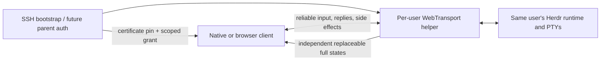

# From a WebTransport pipe to a mosh-style display

This is the next experiment, not a claim that `webtransport-stream-v1` already
implements mosh state synchronization or predictive typing.

Herdr already owns a terminal model on the server. Its client-owned shell renders
local navigation while receiving remote pane surfaces and session metadata. That
is a useful starting point: we should transport the state Herdr already knows,
rather than build a second ANSI parser in an opaque network proxy.

## Why replacing TCP alone is insufficient

The current helper moves the existing ordered endpoint bytes over one reliable
WebTransport stream. Older output in that stream still has to arrive before newer
output. QUIC handles encryption, congestion and path migration, but it does not
know that an obsolete screen can be discarded. It also does not decide whether
an input event has already been applied or whether local echo would be correct.

Local tab-out responsiveness is a separate invariant. The current native client
already schedules Local activation without waiting for the remote release ACK
([activation.rs](src/client/endpoint/activation.rs)), and
[writer.rs](src/client/endpoint/writer.rs) keeps endpoint I/O in bounded worker
queues. Preserve and test that under injected delay and backpressure. A new
transport cannot compensate for a UI thread that waits on a network operation.

## What can already be reused

- `PaneSurfaceFrame` in [wire.rs](src/protocol/wire.rs) carries server boot ID,
  projection revision, surface revision, terminal cells, layout, cursor, popup,
  and graphics scene.
- Existing `ClientShellSnapshot` projection metadata must match the surface.
  Current composition and surface-patch code already checks these revisions.
- [client_transport.rs](src/server/client_transport.rs) separates control and
  render queues, including a one-pending-render slot. They merge into one byte
  stream afterward. Dropping that pending slot cannot retract bytes already
  queued in SSH/TCP or a reliable QUIC stream.
- [endpoint.rs](src/protocol/endpoint.rs) already negotiates immutable named
  snapshot/surface/input/blob codecs and optional capabilities. New state
  semantics can be named separately without changing endpoint generation 1.

Two traps prevent simply dropping existing render messages:

1. Turning off `surface_reuse`, `surface_delta`, and `surface_scroll` does **not**
   disable ordinary `PaneSurfacePatch` messages from the retained-render path
   ([retained_surface.rs](src/server/headless/retained_surface.rs) and
   [render_stream.rs](src/server/render_stream.rs)). A semantic adapter must apply
   every patch to a full retained state before coalescing it.
2. `SurfaceGraphicsScene` has complete placements but only previously-unsent
   image assets. A nominal full surface is not independently usable if earlier
   asset messages were lost. Initially disable graphics for the new experiment,
   include every referenced asset, or use an explicitly acknowledged asset lane.

## Smallest useful next protocol: `webtransport-state-v1`

Keep `webtransport-stream-v1` and `ssh` unchanged. The proposed new name needs both
transport and semantic endpoint support; it is not implemented by the current
helper's supported registry.

Use one reliable ordered stream for input, API replies, and side effects such as
clipboard changes and notifications. Keep presentation separate:

1. The runtime or an internal semantic bridge retains one complete state,
   applying all local patches and asset updates in order. Reuse actual Herdr
   protocol/render types; do not copy frozen bincode variants into an unrelated
   helper or drop arbitrary encoded messages.
2. Build a self-contained envelope containing `{connection_epoch, state_sequence,
   matching_snapshot, full_surface}`. Start with text/cursor/layout/popup only.
3. Hold the latest envelope in a bounded latest-value slot. Send each chosen state
   on an independent unidirectional WebTransport stream, with at most a small
   bounded number in flight. Reset superseded streams instead of finishing old
   screens ahead of the latest one.
4. Read those streams concurrently with strict size/count limits. Present only a
   completed newer state with matching boot/epoch/projection, applying its
   snapshot and surface atomically. An incomplete old state must not block a new
   stream from being read.
5. Test drop, reordering, reset and resize. The final complete state must restore
   the exact display. Control and side effects must remain ordered and must not
   execute twice during presentation loss.

Independent reliable streams are the simplest first experiment. They avoid
inventing datagram fragmentation and can cancel obsolete state. Small replaceable
updates can use datagrams later; keep large frames, images and baseline repair on
streams. Delta compression, FEC, priority, pacing and acknowledgment-based
baselines are research candidates after the full-state version is correct.

## Input acknowledgments and reconnect

Current `ClientShellPaneInput` has pane IDs and events, but no application input
sequence or ACK. Keep QUIC's reliable ordering within a live connection first.
Never replay uncertain input after reconnect merely to make the screen look live.

A later separately named input contract needs client incarnation, server/session
identity, monotonic sequence, cumulative ACK and bounded server deduplication.
Specify what an ACK means: admitted to the router or written to the PTY. Across
runtime restart, a lost dedup store must invalidate the old incarnation instead
of accepting replay. Even PTY write acknowledgment does not imply that the shell
or external program completed an operation.

Predictive echo is another independent layer. A conservative initial policy can
predict simple shell typing only while the terminal model supports it, mark it as
speculative, and roll it back on server disagreement. Full-screen coding agents
and mouse commands need particular care; no predictions should send extra input.

## Browser roadmap

The first browser demo uses local xterm.js to render a genuine remote Herdr TUI in
a PTY. This shares the real Herdr UI and avoids a premature browser implementation
of endpoint codecs. It is still an ordered terminal byte stream and does not
supply latest-state behavior.

A more integrated browser client should consume the structured snapshot/surface
contract, render local navigation itself, and share the same state-stream logic
as native clients. A canvas/cell renderer or a small adapter that atomically
renders full cells through xterm can be explored before committing to a large UI
framework. Keep transport, authorization, retained terminal state, and client
presentation as independent boundaries.

## Multi-user boundary

Stock Herdr already places sockets under each OS user's config directory, with
owner-only permissions (0600), and named sessions under that user's
`sessions/<name>`. The helper runs as the authenticated SSH login user and creates
only a per-attachment UDP listener; no shared root daemon is required. Two users
on one machine can have separate Herdr runtimes and attachment grants.

Named sessions separate workflows **within** an OS user. They do not isolate
agents with the same UID from each other. Stronger agent isolation belongs in
separate Unix users or containers, alongside resource limits, rather than in
transport names.
